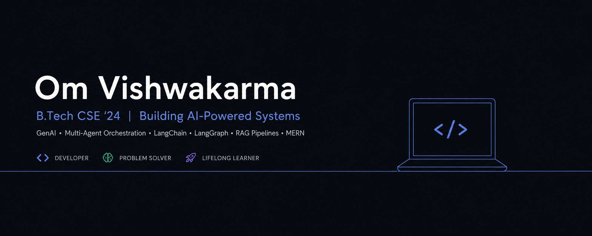

  

  
  
  
  

 

## About

Hi, I'm **Om Vishwakarma**, a third-year B.Tech CSE student at PSIT Kanpur (graduating 2028). I build production-shaped GenAI systems: multi-agent workflows, retrieval pipelines, and full-stack products that are deployed, authenticated and shipped through CI/CD.

- 🔭 **Building:** InnovateX, a Developer Intelligence Platform powered by LangGraph agents
- 🚀 **Shipped:** BuildPath, an AI project-blueprint platform, live at [getbuildpath.tech](https://getbuildpath.tech)
- 📜 **Preparing for:** AWS Certified AI Practitioner (AIF-C01)
- 🛰️ **Exploring:** deep-learning super-resolution for satellite imagery (final-year project track)
- 🎯 **Looking for:** GenAI / Full-Stack / SDE internships and campus placements
- ⚙️ **Core stack:** Python • LangChain • LangGraph • ChromaDB • Mistral AI • FastAPI/Flask • MERN

 

## Tech Stack

  

<table align="center">
<tr>
<td valign="top" width="33%">

**GenAI / ML**
LangChain · LangGraph · Multi-Agent Systems · RAG · ChromaDB · Mistral AI · Gemini · Prompt Engineering

</td>
<td valign="top" width="33%">

**Backend / Full-Stack**
FastAPI · Flask · Node.js · Express · React · MongoDB · MySQL · REST APIs · JWT / OAuth · SSE Streaming

</td>
<td valign="top" width="33%">

**DevOps / Cloud**
Docker · GitHub Actions · Azure Container Apps · Vercel · CI/CD · Cron Jobs

</td>
</tr>
</table>

 

## Featured Projects

<table>
<tr>
<td width="50%" valign="top">

### 🧠 [InnovateX: Developer Intelligence Platform](https://github.com/loqom)
A five-module platform that helps developers grow faster, driven by four LangGraph agent graphs and real data sources:

- **GitHub Profile Analyzer** with a 24h cache
- **Research Paper Agent** (Semantic Scholar + ArXiv)
- **Open Source Contribution Finder**
- **CP Contest Tracker** (Codeforces, LeetCode, CLIST) refreshed by a 6-hour cron
- **Multi-Agent Job Search**

Express + MongoDB backend with JWT auth, a FastAPI AI service, and a React + Vite frontend.

`LangGraph` `LangChain` `Gemini` `FastAPI` `Express` `MongoDB` `React`

</td>
<td width="50%" valign="top">

### 🛤️ [BuildPath](https://getbuildpath.tech) · 🟢 Live
Turns real developer problems (GitHub, Stack Overflow, Reddit) into personalised project blueprints with architecture, tech stack and a 4-week roadmap.

**Pipeline:** problem discovery → semantic analysis → clustering → skill matching → AI planning → roadmap, with streamed responses over SSE.

Deployed on Azure Container Apps with Docker, GitHub Actions CI/CD, immutable SHA-tagged images, health checks, JWT + Google OAuth.

`React` `Node.js` `FastAPI` `LangChain` `Mistral` `MongoDB` `Azure` `Docker`

[Frontend](https://github.com/loqom/BuildPathFrontend) · [Backend](https://github.com/loqom/Project-web-backend)

</td>
</tr>
</table>

 

## Hackathons

- **Smart India Hackathon 2025:** Team Zillion Minds, *Astroverse* (SIH25175), a space-tech project

 

## GitHub Stats

  
  

  

  

 

  

